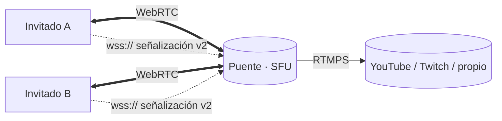

# ether-webrelay

Antesala y **videollamada de navegador** para transmisiones en vivo. El
invitado abre un enlace de invitación, prueba cámara, micrófono, altavoz y
efectos (desenfoque o fondo virtual) en el lobby, escribe su nombre y entra a
una sala donde **ve y oye a los demás participantes**. Sus medios viajan por
**WebRTC** al **puente**, que compone la sala y la publica en **RTMPS**
(YouTube, Twitch o servidor propio).

> Este repositorio es **solo el frontend** y nunca conoce RTMPS. El puente vive
> en [`ether-streaming-culerin`](https://github.com/rafex/ether-streaming-culerin);
> el contrato entre ambos es la [señalización v2](docs/signaling.md).



## Inicio rápido

```bash
just setup              # git hooks + dependencias
just bridge-dev         # puente de desarrollo (señalización + mini SFU)
just dev                # http://localhost:5173/join/demo?t=dev
```

En contenedor (podman → docker):

```bash
just up --port 8080 --bridge-url wss://puente.example.com/signal
just down
```

Calidad (lo mismo que corre GitHub Actions):

```bash
make ci                 # install + lint + build + test dentro del contenedor
make e2e-ci             # Playwright: lobby + llamada real entre dos participantes
```

`make help` y `just --list` muestran todas las tareas; cada una tiene manual:
`make man TARGET=<tarea>` o `just <receta> --man`.

## Funcionalidades

- Lobby: info de la sala (anfitrión, título, canales), vista previa en espejo,
  micrófono/cámara con selector de dispositivo, medidor de nivel, nombre y
  título.
- Ajustes: video (entrada, resolución, espejo), audio (micrófono, altavoz,
  eco, ruido, ganancia), fondo virtual (desenfoque, fondos, imagen propia),
  perfil y atajos de teclado.
- Llamada: tres vistas conmutables (escenario, mínima, escenario +
  estadísticas), compartir pantalla en caliente, reconexión automática.
- Grabación local de la llamada (WebM, exportable a OGV con ffmpeg.wasm).
- Modo alternativo "solo emisor" por WebSocket + WebCodecs
  ([protocolo binario v1](docs/protocol-websocket.md)).

## Stack

TypeScript 7 · Vite 8 · Pug 3 · WebRTC · WebCodecs · Web Audio · MediaPipe ·
ffmpeg.wasm · Vitest · Playwright · Biome · Podman · MkDocs.
Detalle en [spec-native/STACK.md](spec-native/STACK.md).

## Estructura

```text
source/frontend/nodejs/webrelay/   aplicación (hexagonal)
  src/domain/          señalización, sala, invitación, perfil de calidad, protocolo v1…
  src/ports/           señalización, WebRTC, dispositivos, preferencias, efectos…
  src/application/     LobbyService, WebRtcCallSession, WebSocketCallSession…
  src/infrastructure/  WebSocket, RTCPeerConnection, getUserMedia, MediaPipe, WebCodecs…
  src/ui/ + src/templates/   lobby, llamada y ajustes sobre plantillas Pug
  tests/               unit · integration · architecture · e2e (Playwright)
  tests/support/dev-bridge.mjs   puente de desarrollo (doble de prueba)
helpers/               mk · shell · just — capa única de ejecución
containers/            ci/, frontend/ y e2e/ (Containerfile)
docs/                  señalización, arquitectura, guías y manuales (MkDocs)
spec-native/           contexto para agentes (SpecNative)
```

## Documentación

- [Guía de inicio](docs/getting-started.md)
- [Levantar el frontend](docs/running-frontend.md) — desarrollo, contenedor, TLS
- [Arquitectura](docs/architecture.md)
- [Señalización v2](docs/signaling.md) — contrato con el puente
- [Protocolo binario v1](docs/protocol-websocket.md) — modo alternativo
- Contexto del proyecto para agentes: [AGENTS.md](AGENTS.md) →
  [spec-native/](spec-native/README.md)

## Licencia

[MIT](LICENSE)
