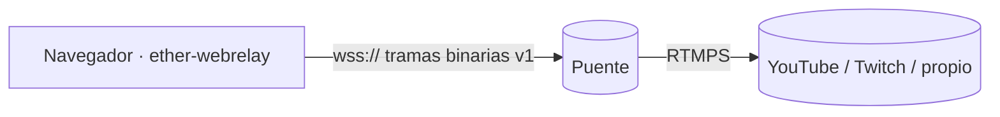

# ether-webrelay

Relay **de navegador** para transmisiones en vivo. Captura cámara, micrófono,
pantalla (pestaña, ventana o pantalla completa) y audio del sistema; los
codifica con **WebCodecs** (H.264 + AAC, con VP8/Opus de respaldo) y los
envía por **WebSocket** (`wss://`) a un **puente externo** que publica en
**RTMPS** (YouTube, Twitch o servidor propio).

> Este repositorio es **solo el frontend**. El puente es otro sistema; el
> contrato entre ambos es el [protocolo v1](docs/protocol.md).



## Inicio rápido

```bash
just setup              # git hooks + dependencias
just dev                # http://localhost:5173
```

En contenedor (podman → docker):

```bash
just up --port 8080     # http://localhost:8080
just down
```

Calidad (lo mismo que corre GitHub Actions):

```bash
make ci                 # install + lint + build + test dentro del contenedor
```

`make help` y `just --list` muestran todas las tareas; cada una tiene manual:
`make man TARGET=<tarea>` o `just <receta> --man`.

## Stack

TypeScript 7 · Vite 8 · Pug 3 · WebCodecs · Web Audio (AudioWorklet) ·
ffmpeg.wasm (solo exportación OGV) · Vitest · Biome · Podman · MkDocs.
Detalle en [spec-native/STACK.md](spec-native/STACK.md).

## Estructura

```text
source/frontend/nodejs/webrelay/   aplicación (hexagonal)
  src/domain/          protocolo, reloj, timeline de audio, políticas, códecs
  src/ports/           MediaPipelinePort, TransportPort, Timer, TranscoderPort
  src/application/     RelaySession, BridgeLink
  src/infrastructure/  captura, compositor, Web Audio, WebCodecs, WebSocket, ffmpeg.wasm
  src/ui/ + src/templates/   UI sobre plantillas Pug
  tests/               unit · integration (puente simulado) · architecture
helpers/               mk · shell · just — capa única de ejecución
containers/            ci/ y frontend/ (Containerfile)
docs/                  protocolo, arquitectura, manuales de tareas (MkDocs)
spec-native/           contexto para agentes (SpecNative)
```

## Documentación

- [Guía de inicio](docs/getting-started.md)
- [Arquitectura](docs/architecture.md)
- [Protocolo v1](docs/protocol.md) — para quien implemente el puente
- Contexto del proyecto para agentes: [AGENTS.md](AGENTS.md) →
  [spec-native/](spec-native/README.md)

## Licencia

[MIT](LICENSE)
