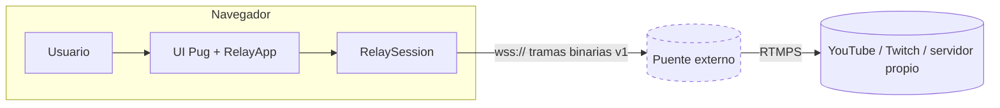
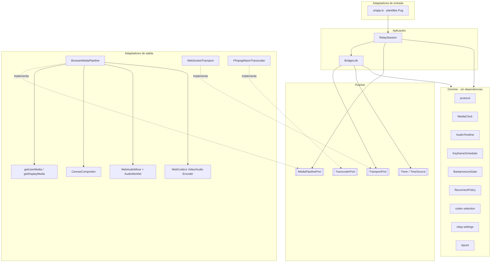
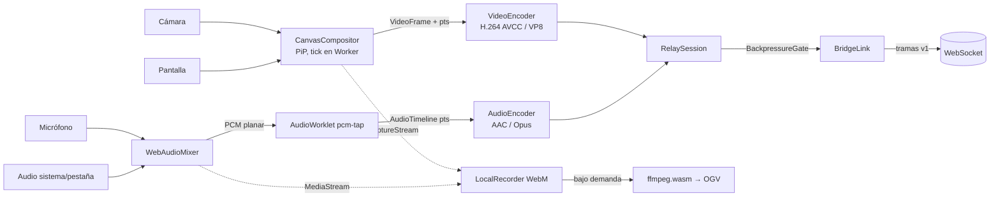
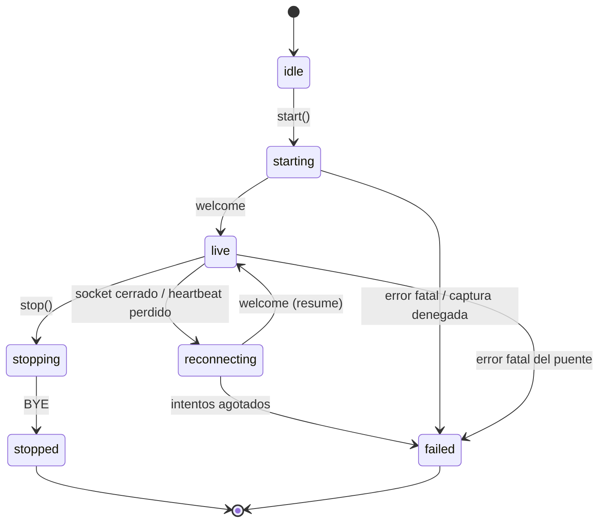

# Arquitectura

Ether WebRelay es **solo frontend**: una aplicación TypeScript (Vite + Pug)
que corre en el navegador. Captura, compone, codifica y entrega por WebSocket
a un puente externo que publica en RTMPS.

## Contexto

El puente (línea punteada) está fuera del alcance de este repositorio; su
contrato es [el protocolo](protocol.md).

## Hexágono

### Reglas de dependencia

| Capa | Puede importar | No puede importar |
|------|----------------|-------------------|
| `domain/` | nada (solo tipos propios) | ports, application, infrastructure, ui, APIs del navegador |
| `ports/` | `domain/` | application, infrastructure, ui |
| `application/` | `domain/`, `ports/` | infrastructure, ui, APIs del navegador |
| `infrastructure/` | `domain/`, `ports/` | application, ui |
| `ui/` | todas | — |

Consecuencia: dominio y aplicación se prueban en Node sin navegador (fakes de
`MediaPipelinePort`, `TransportPort` y `Timer`).

## Flujo de medios

- **Un solo reloj** (`MediaClock`) estampa video y audio.
- **Ticks en Worker**: los timers del hilo principal se ralentizan en pestañas
  ocultas (habitual al compartir pantalla).
- **ffmpeg.wasm** solo para formatos que WebCodecs no produce (OGV), cargado
  bajo demanda: nunca interfiere con la transmisión en vivo.

## Máquina de estados de la sesión

