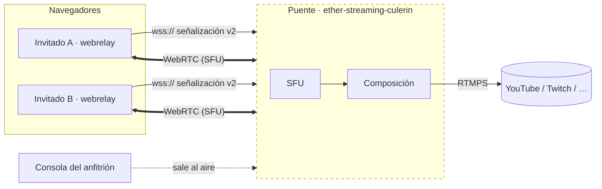
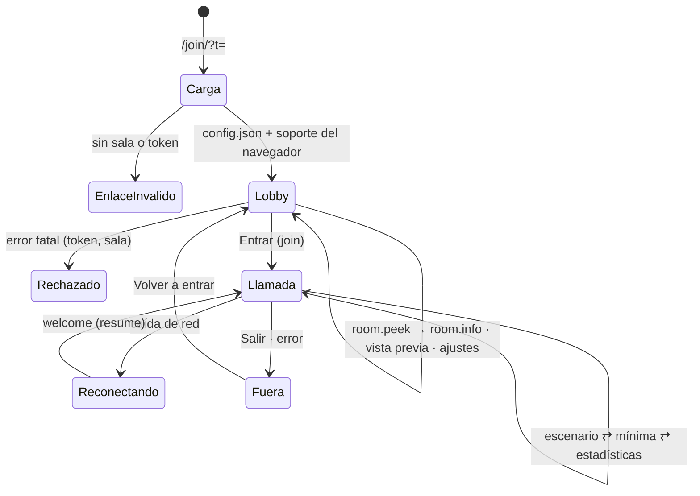
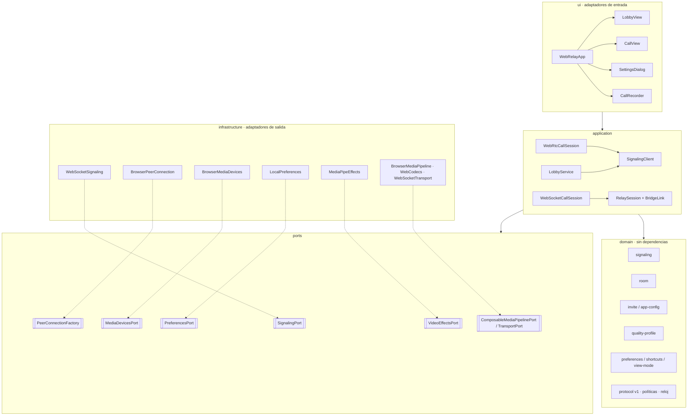
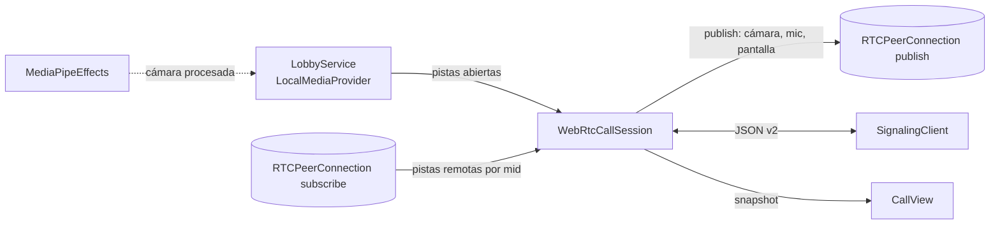

# Arquitectura

Ether WebRelay es **solo frontend**: una aplicación TypeScript (Vite + Pug)
donde el invitado entra a una **videollamada** desde un enlace, ve a los demás
participantes y envía su cámara, pantalla y audio al **puente**
([`ether-streaming-culerin`](https://github.com/rafex/ether-streaming-culerin)),
que compone la sala y la publica en RTMPS. El cliente nunca conoce RTMPS.

## Contexto

- Contrato principal: [señalización v2](signaling.md).
- Modo alternativo "solo emisor": [protocolo binario v1](protocol-websocket.md)
  con WebCodecs.

## Flujo del invitado

## Hexágono

### Reglas de dependencia

| Capa | Puede importar | No puede importar |
|------|----------------|-------------------|
| `domain/` | nada | ports, application, infrastructure, ui, APIs del navegador |
| `ports/` | `domain/` | application, infrastructure, ui |
| `application/` | `domain/`, `ports/` | infrastructure, ui, APIs del navegador |
| `infrastructure/` | `domain/`, `ports/` | application, ui |
| `ui/` | todas | — |

`tests/architecture/layers.test.ts` hace cumplir estas reglas. Por eso la
grabación (que depende del snapshot de la llamada) vive en `ui/`.

## Llamada WebRTC

- **Una sola conexión de señalización** compartida por lobby y llamada
  (`SignalingClient`: backoff, heartbeat, errores fatales con mensajes
  amigables).
- Los mensajes se procesan **en orden** (cola de promesas); el ICE remoto se
  encola hasta tener descripción remota.
- Renegociación **serializada**: peticiones solapadas se agrupan; video y
  audio de la pantalla salen en una sola oferta.
- Cámara/pantalla on-off y cambios de dispositivo o efecto usan
  `replaceTrack`; silenciar solo desactiva la pista.
- El perfil del puente se aplica a los senders (bitrate escalado al área
  realmente enviada).
- Cada dispositivo de la vista previa se muestra en cuanto abre: un permiso de
  micrófono pendiente no bloquea la cámara.

## Modo alternativo `websocket`

`WebSocketCallSession` ofrece el mismo `CallController` sobre `RelaySession`:
las pistas del lobby entran a `BrowserMediaPipeline` (compositor en canvas +
mezclador Web Audio + WebCodecs), que acepta cambios de fuentes en caliente.
Se elige con `transport` en `config.json` o en `room.info`.

## Efectos y grabación

- **Efectos** (`MediaPipeEffects`): segmentación a 256 px con el selfie
  segmenter de MediaPipe; desenfoque por reducción-ampliación (sin filtros de
  canvas) o fondo procedural/subido. Wasm empaquetado y carga diferida; si
  falla, la cámara sigue sin efecto.
- **Grabación** (`CallRecorder`): mosaico igual al escenario + audio mezclado
  → WebM (MediaRecorder); exportable a OGV con ffmpeg.wasm bajo demanda.

## Configuración en tiempo de ejecución

`/config.json` (o variables `WEBRELAY_*` en el contenedor) define
`bridgeUrl`, `relayUrl`, `transport`, `defaultProfile`, `defaultView` y
`effectsModelUrl`. Ninguna credencial ni destino RTMPS forma parte de la
configuración del cliente.
