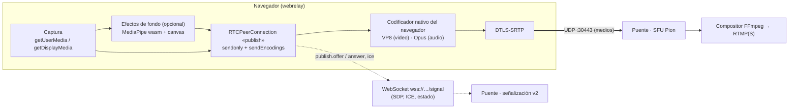

# Flujo de medios: ¿quién envía el video del cliente al puente, y cómo?

**Lo envía el navegador**, con WebRTC. El código del webrelay (TypeScript) no
codifica ni empaqueta nada en el modo normal (`transport: webrtc`): captura las
pistas, se las entrega a un `RTCPeerConnection` nativo, negocia la conexión por
WebSocket y, a partir de ahí, el motor de WebRTC del navegador codifica,
cifra y transmite por **UDP** directamente al SFU del puente.



Hay **dos canales distintos** y conviene no confundirlos:

| Canal | Protocolo | Qué lleva | Puerto |
|-------|-----------|-----------|--------|
| Señalización | WebSocket (`wss://`, JSON, subprotocolo `ether-webrelay.signaling.v2`) | SDP, candidatos ICE, presencia, perfil de calidad, `self.update` | 443 (por HAProxy) |
| Medios | **UDP**, DTLS-SRTP | Video, audio y pantalla (RTP cifrado) | un único UDP del puente (30443 en k3s) |

El WebSocket **nunca transporta video**. El contrato completo de señalización
está en [signaling.md](signaling.md).

## 1. Captura

| Fuente | API del navegador | Dónde en el código |
|--------|-------------------|--------------------|
| Cámara | `getUserMedia({video})` con `width`/`height` ideales y `frameRate` máximo del perfil; `contentHint = 'motion'` | `infrastructure/devices/browser-media-devices.ts` (`camera`) |
| Micrófono | `getUserMedia({audio})` con eco, ruido y ganancia automática configurables | `microphone` |
| Pantalla | `getDisplayMedia({video, audio})` con `frameRate` ideal = `screenFramerate` del perfil, hasta 4K; `contentHint = 'detail'` | `screen` |

Cada llamada produce un `MediaStreamTrack`. Si el invitado activa un **efecto
de fondo**, la pista de cámara pasa antes por un canvas
(`infrastructure/effects/mediapipe-effects.ts`): MediaPipe segmenta a la
persona (módulo WebAssembly, con GPU si está disponible), se desenfoca o
sustituye el fondo y `canvas.captureStream()` entrega la pista procesada. Si el
efecto falla se envía la cámara sin tocar: la llamada nunca pierde video por un
efecto.

## 2. Dos conexiones: «publish» y «subscribe»

Cada participante mantiene dos `RTCPeerConnection` con el SFU
(`application/webrtc-call.ts`, `WebRtcCallSession`):

- **publish** (esta guía): la ofrece el navegador, todas las pistas van
  `sendonly`.
- **subscribe**: la ofrece el puente y lleva las pistas de **los demás**
  participantes (`recvonly` en el navegador).

`bundlePolicy: 'max-bundle'`: todas las pistas viajan por un único transporte
y un único puerto.

## 3. Cómo se publica (secuencia)

```mermaid
sequenceDiagram
    participant N as Navegador (webrelay)
    participant W as WebSocket (señalización)
    participant P as Puente (SFU Pion)
    N->>W: join {name, media}
    W-->>N: welcome {perfil, iceServers, participantes}
    Note over N: addTransceiver(track, sendonly,<br/>sendEncodings = perfil)
    N->>W: publish.offer {sdp, sources: {mid → camera|microphone|screen}}
    W-->>N: publish.answer {sdp}
    N-)W: ice (trickle, ambos sentidos)
    Note over N,P: ICE conecta · DTLS establece claves
    N==>P: RTP/SRTP por UDP (VP8 + Opus), directo al puerto del puente
    P-->>N: RTCP (NACK, PLI, TWCC) por la misma vía
    N->>W: self.update {muted, cameraOff, screenSharing}
```

Pasos y dónde ocurren:

1. **`join`** (`sendJoin`): el invitado entra con su nombre y qué medios tiene.
   El puente responde `welcome` con el **perfil de calidad** y los servidores
   ICE.
2. **`addTransceiver`** (`infrastructure/webrtc/browser-peer-connection.ts`,
   `addSender`): por cada pista (`camera`, `microphone`, `screen`,
   `screenAudio`) se crea un transceiver `sendonly` con `sendEncodings`
   (bitrate máximo, fps máximo, reducción de escala) calculados desde el perfil
   (`domain/quality-profile.ts`).
3. **Oferta SDP** (`negotiate` → `createOffer`): se envía como `publish.offer`
   con `sources`, que le dice al SFU qué *mid* es cámara y cuál pantalla (no se
   puede deducir del tipo de medio). No se ofrece nada hasta tener al menos una
   pista: una oferta sin secciones de medios es inválida con `max-bundle`.
4. **ICE**: los candidatos viajan por el WebSocket (`ice`, *trickle*); se
   encolan hasta tener la descripción remota. Con ICE completado el navegador
   envía los paquetes **directo por UDP** a la dirección anunciada por el
   puente (`BRIDGE_ICE_PUBLIC_IPS:BRIDGE_ICE_UDP_PORT`).
5. **Los medios** salen por el motor nativo de WebRTC (ver §4).

## 4. Qué hace el navegador con cada pista

| Etapa | Quién | Detalle |
|-------|-------|---------|
| Codificación de video | **Codificador nativo del navegador** | Se negocia en el SDP; con el puente actual se usa **VP8** (el SFU acepta VP8, H.264 y Opus). No hay código del webrelay en esta etapa |
| Codificación de audio | Codificador nativo | **Opus** (48 kHz); eco, ruido y ganancia los aplica el navegador al capturar |
| Control de congestión | Navegador (TWCC/REMB) | Ajusta el bitrate real **por debajo** del máximo del perfil según la red |
| Retransmisión | NACK/PLI | El puente pide retransmitir paquetes o un fotograma clave; el navegador responde |
| Cifrado | DTLS-SRTP | Obligatorio en WebRTC; el puente solo ve RTP tras descifrar |

### Del perfil del puente a los parámetros del emisor

El puente dicta el perfil (`welcome.profile`, configurable con `BRIDGE_PROFILE`)
y el webrelay lo traduce a `RTCRtpEncodingParameters`
(`setParameters`/`sendEncodings`); el invitado solo elige la resolución de su
cámara (Automática/360p/720p/1080p), siempre acotada por el perfil.

| Campo del perfil | Efecto en el navegador |
|------------------|------------------------|
| `width`, `height`, `framerate` | Restricciones de captura de la cámara y tope de fps |
| `videoBitrate` | `maxBitrate` de la cámara, **proporcional al área enviada** (360p bajo un perfil 720p no desperdicia ancho de banda) |
| `audioBitrate` | Solo en el modo `websocket` (WebCodecs). En WebRTC el navegador usa su bitrate de Opus por defecto |
| `screenFramerate` | `frameRate` pedido a `getDisplayMedia` **y** `maxFramerate` del emisor de pantalla |
| `screenBitrate` | `maxBitrate` del emisor de pantalla; se reduce la escala para no pasar de 1080p |

!!! tip "La pantalla compartida y los fps"
    El perfil por defecto usa **15 fps** y 2–2.5 Mbps para la pantalla
    (favorece el detalle sobre el movimiento). Si compartes contenido con
    movimiento (video, juegos, animaciones), súbelo a 30 fps y ~4 Mbps en el
    puente: `BRIDGE_PROFILE='{"screenFramerate":30,"screenBitrate":4000000}'`.

## 5. Cambios en caliente sin renegociar

| Acción | Qué ocurre | Renegocia |
|--------|------------|-----------|
| Silenciar micrófono | `track.enabled = false` (el emisor sigue enviando silencio) + `self.update` | No |
| Apagar cámara | `sender.replaceTrack(null)` + `self.update` | No |
| Encender cámara / cambiar de dispositivo | `replaceTrack(nuevaPista)` + `setParameters` | No (si ya hay transceiver) |
| Compartir pantalla | `addTransceiver` para video y audio de la pestaña, **una sola** negociación | Sí, una vez |
| Dejar de compartir | `replaceTrack(null)` | No |
| Cambia el perfil (`profile`) | `setParameters` de cámara y pantalla | No |
| Cae el transporte de medios | `createOffer({iceRestart: true})` | Sí |
| Cae el WebSocket | `join {resume}`; el puente conserva la sesión 20 s | No |

El estado visible (silenciado, cámara apagada, compartiendo) viaja aparte en
`self.update`, para que los demás y el puente lo reflejen.

## 6. Qué recibe el puente

El SFU Pion (`ether-streaming-culerin`) recibe esas pistas, las reenvía a los
demás participantes por sus conexiones *subscribe* y, mientras hay emisión,
copia los paquetes RTP por UDP local a FFmpeg, que compone la sala, la codifica
a H.264/AAC y la publica por RTMP(S). Ver su documentación de composición.

## 7. Estadísticas y diagnóstico en el cliente

La vista «Estadísticas» de la llamada usa `RTCPeerConnection.getStats()`
(`domain/call-stats.ts`) y muestra bitrate de subida y bajada, RTT, pérdida de
paquetes entrantes, fps y resolución enviados, códec y tipo de candidato
(`host`, `srflx`, `relay`). Para el detalle fino (por ejemplo
`qualityLimitationReason`, que indica si el navegador baja la calidad por CPU o
por ancho de banda) usa `chrome://webrtc-internals`. Primera herramienta ante
«se ve mal»:

| Síntoma | Qué mirar |
|---------|-----------|
| Video borroso o a baja resolución | Resolución y bitrate de subida frente a `videoBitrate`; en `webrtc-internals`, `qualityLimitationReason` (CPU o ancho de banda) |
| Saltos o congelamientos | Pérdida, RTT y fps enviados frente al perfil |
| Pantalla compartida entrecortada | fps de la pantalla (`screenFramerate`); el contenido se actualiza a ese máximo aunque la emisión final sea de 30 fps |
| No llega video, sí presencia | UDP bloqueado (firewall del servidor o de la red del invitado): el candidato debe verse `connected` en `chrome://webrtc-internals` |

## 8. WebAssembly en el cliente (hoy)

WebAssembly **no participa en el envío** del video; sí aparece en dos sitios:

| Uso | Dónde | Cuándo se carga |
|-----|-------|-----------------|
| Segmentación para fondo virtual (MediaPipe) | `infrastructure/effects/mediapipe-effects.ts` | Bajo demanda, al activar un efecto |
| Exportación de la grabación local a OGV (ffmpeg.wasm) | `infrastructure/recording/` | Bajo demanda, al exportar |

## 9. Modo alternativo `websocket`

Con `transport: websocket` el flujo es otro: aquí **sí codifica el código del
webrelay**, con WebCodecs, y envía el video por **WebSocket binario**
([protocolo v1](protocol-websocket.md)). No recibe a otros participantes. No es
el modo recomendado cuando hay un SFU.

## Mapa del código

| Responsabilidad | Archivo |
|-----------------|---------|
| Sesión de llamada WebRTC (join, negociación, toggles, ICE, estadísticas) | `src/application/webrtc-call.ts` |
| Adaptador de `RTCPeerConnection` (`addTransceiver`, `replaceTrack`, `setParameters`) | `src/infrastructure/webrtc/browser-peer-connection.ts` |
| Captura de cámara, micrófono y pantalla | `src/infrastructure/devices/browser-media-devices.ts` |
| Perfil → restricciones de captura y parámetros del emisor | `src/domain/quality-profile.ts` |
| Mensajes de señalización | `src/domain/signaling.ts`, `src/application/signaling-client.ts` |
| Efectos de fondo | `src/infrastructure/effects/mediapipe-effects.ts` |
