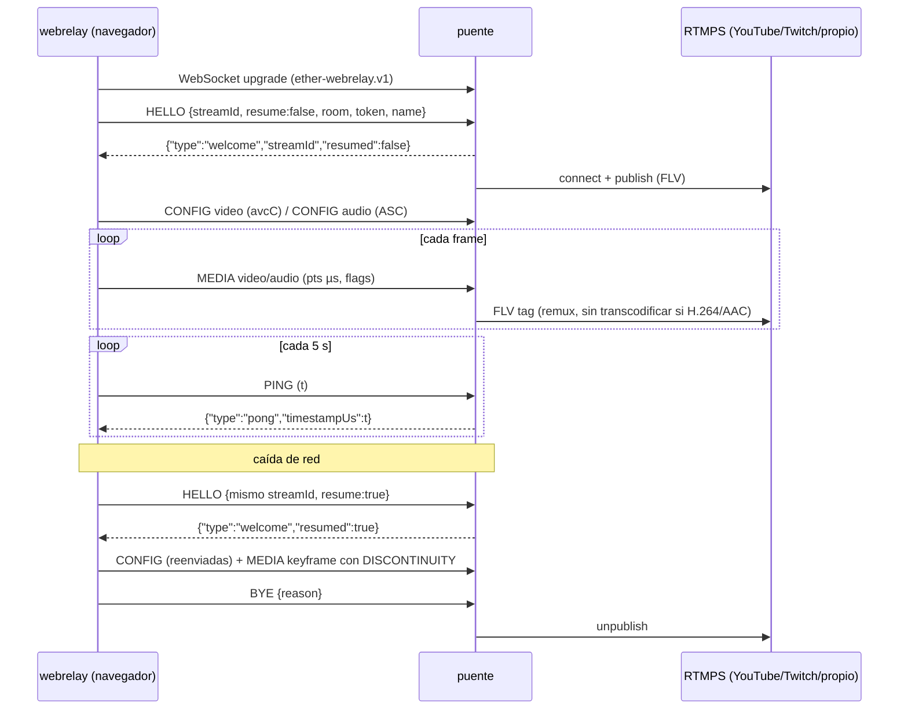

# Protocolo Ether WebRelay v1

Contrato entre el **webrelay** (este repositorio, navegador) y el **puente**
(servidor externo que publica en RTMPS). El puente no forma parte de este
repositorio; este documento es lo único que necesita para implementarlo.

La implementación de referencia del lado cliente vive en
`source/frontend/nodejs/webrelay/src/domain/protocol.ts` y está cubierta por
`tests/unit/protocol.test.ts`.

## Transporte

- WebSocket sobre TLS: `wss://`. (`ws://` solo para `localhost` en desarrollo.)
- Subprotocolo: `ether-webrelay.v1` (cabecera `Sec-WebSocket-Protocol`).
  El puente debe aceptarlo o rechazar el upgrade.
- **Cliente → puente:** mensajes **binarios**, una trama por mensaje.
- **Puente → cliente:** mensajes de **texto** JSON UTF-8.



## Formato de trama (binario)

Cabecera fija de 28 bytes, enteros **big-endian**, seguida del payload.

| Offset | Tamaño | Campo | Descripción |
|-------:|-------:|-------|-------------|
| 0 | 2 | magic | `0x4557` (`"EW"`) |
| 2 | 1 | version | `1` |
| 3 | 1 | type | ver [Tipos](#tipos-de-trama) |
| 4 | 1 | track | `0` control · `1` video · `2` audio |
| 5 | 1 | flags | bit0 `KEYFRAME` · bit1 `DISCONTINUITY` |
| 6 | 2 | reserved | `0` |
| 8 | 4 | sequence | u32, +1 por trama enviada (todas), **continúa tras reconexión**, da la vuelta en 2³² |
| 12 | 8 | timestamp | i64, µs de presentación en el **reloj de sesión** |
| 20 | 4 | duration | u32, µs |
| 24 | 4 | payload length | u32, debe coincidir con el resto del mensaje |
| 28 | n | payload | bytes del códec, o JSON UTF-8 en tramas de control |

El puente **debe** rechazar tramas con `magic`, `version`, `type` o `track`
desconocidos, o con longitud inconsistente.

### Tipos de trama

| type | Nombre | track | Payload |
|-----:|--------|-------|---------|
| `0x01` | HELLO | 0 | JSON `HelloPayload` |
| `0x02` | CONFIG | 1 / 2 | JSON `TrackConfig` |
| `0x10` | MEDIA | 1 / 2 | muestra codificada |
| `0x20` | PING | 0 | vacío; `timestamp` es un valor opaco del cliente |
| `0x30` | BYE | 0 | JSON `{ "reason": string }` |

### HELLO

```json
{
  "protocol": "ether-webrelay",
  "version": 1,
  "streamId": "wr-6f0c…",
  "resume": false,
  "room": "jdh-s02e38",
  "token": "<token del enlace de invitación>",
  "name": "Raúl",
  "title": "Invitado",
  "tracks": ["video", "audio"],
  "userAgent": "…"
}
```

- `streamId` identifica la transmisión; se reutiliza en cada reconexión.
- `resume: true` indica que el cliente continúa una transmisión previa.
- `room` y `token` vienen del enlace de invitación; el puente los asocia a
  sus destinos RTMPS. **El cliente nunca conoce URLs ni claves RTMPS.**
- `name` y `title` identifican al participante (rótulos en la emisión).
- Debe ser la primera trama. El cliente espera `welcome` durante 5 s; si no
  llega, cierra y reintenta.

### CONFIG

Se envía al iniciar, cuando cambia la configuración del encoder y **después
de cada reconexión** (antes del primer MEDIA de la pista).

```json
{ "track": "video", "codec": "avc1.64001F", "family": "h264",
  "width": 1280, "height": 720, "framerate": 30, "bitrate": 2500000,
  "description": "<base64 avcC>" }
{ "track": "audio", "codec": "mp4a.40.2", "family": "aac",
  "sampleRate": 48000, "channels": 2, "bitrate": 128000,
  "description": "<base64 AudioSpecificConfig>" }
```

| family | Muestras MEDIA | `description` | Acción típica del puente |
|--------|----------------|---------------|--------------------------|
| `h264` | AVCC (NALUs con prefijo de longitud de 4 bytes) | `AVCDecoderConfigurationRecord` | Remux a FLV (`AVC sequence header` + NALU) |
| `vp8` | frames VP8 | — | Transcodificar a H.264 |
| `aac` | AAC-LC raw (sin ADTS) | `AudioSpecificConfig` | Remux a FLV (`AAC sequence header` + raw) |
| `opus` | paquetes Opus | `OpusHead` (si el navegador lo provee) | Transcodificar a AAC |

### MEDIA

- `timestamp`: PTS en µs del **mismo reloj** para audio y video → el puente
  puede intercalar ambas pistas directamente. Monótono por pista.
- Audio: timestamps derivados del conteo de muestras (contiguos, sin jitter).
- `KEYFRAME`: muestra de acceso aleatorio (IDR en H.264).
- `DISCONTINUITY`: primera muestra de la pista tras una (re)conexión o un
  hueco por congestión. El puente debe reiniciar el estado del decodificador /
  muxer de esa pista. En video siempre coincide con `KEYFRAME`.
- Intervalo de keyframes configurable (2 s por defecto, recomendado por las
  ingestas RTMP). El puente puede pedir uno con `keyframe-request`.

## Mensajes del puente (texto JSON)

| type | Campos | Efecto en el cliente |
|------|--------|----------------------|
| `welcome` | `streamId`, `resumed` | Handshake completo; reenvía CONFIG y fuerza keyframe |
| `keyframe-request` | — | Fuerza un keyframe lo antes posible |
| `pong` | `timestampUs` (eco del PING) | Calcula RTT |
| `ack` | `sequence` | Informativo |
| `status` | `state`: `connecting\|publishing\|reconnecting\|stopped`, `detail?` | Informativo |
| `error` | `code`, `message`, `fatal` | `fatal: true` → el cliente **no** reintenta |

Mensajes desconocidos se ignoran (compatibilidad hacia adelante).

## Reconexión y continuidad

1. Si el socket se cierra o queda en silencio más de 3 intervalos de
   heartbeat, el cliente reconecta con backoff exponencial
   (0.5 s → 10 s, ±20 % jitter, 20 intentos por defecto).
2. Reenvía `HELLO` con el **mismo** `streamId` y `resume: true`.
3. El reloj de sesión y `sequence` **continúan**: no hay saltos hacia atrás.
4. Tras `welcome`: CONFIG de cada pista, después MEDIA. El video se descarta
   hasta el siguiente keyframe, que llega marcado `KEYFRAME | DISCONTINUITY`.

Recomendación para el puente: mantener la sesión RTMPS abierta durante un
periodo de gracia (p. ej. 10–15 s) tras perder el socket, y contestar
`resumed: true` si el `streamId` coincide, para no cortar la transmisión
pública.

## Contrapresión

El cliente vigila `WebSocket.bufferedAmount`:

- > 2 MiB: descarta frames de video delta y espera un keyframe.
- > 8 MiB: descarta también audio.

Un puente lento verá huecos marcados con `DISCONTINUITY`, nunca muestras
corruptas.

## Seguridad

- Solo `wss://` fuera de `localhost`.
- `token` viaja dentro de HELLO (no en la URL del WebSocket, que suele acabar en logs).
- Los destinos RTMPS se resuelven solo en el puente.
- El puente debe limitar tamaño de trama (el cliente nunca envía payloads
  > 16 MiB) y validar `Origin`.

## Referencia: de MEDIA a FLV/RTMPS con FFmpeg

Ejemplo orientativo para un puente que recibe H.264 (AVCC) + AAC (raw):
convertir a Annex-B / ADTS y alimentar FFmpeg por tuberías.

```bash
ffmpeg -f h264 -i video.pipe -f aac -i audio.pipe \
  -c copy -f flv "rtmps://a.rtmps.youtube.com/live2/$STREAM_KEY"
```

Con timestamps precisos es preferible un muxer FLV propio (o
`-use_wallclock_as_timestamps 0` con un contenedor intermedio como NUT/MPEG-TS
que preserve los PTS del protocolo).
