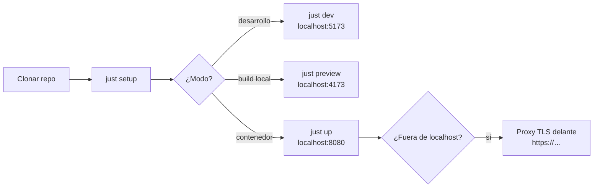

# Levantar el frontend

Guía operativa para poner en marcha Ether WebRelay en tres modos:
**desarrollo** (Vite con recarga), **preview** (build de producción local) y
**contenedor** (imagen nginx servible). Todos los comandos se ejecutan desde la
raíz del repositorio y delegan en `helpers/shell/` (regla 01).

Los invitados entran siempre por un **enlace de invitación**:

```text
http://localhost:5173/join/<sala>?t=<token>
```

La app lee `/config.json` para saber dónde está el puente
([señalización v2](signaling.md)); el puente real vive en
[`ether-streaming-culerin`](https://github.com/rafex/ether-streaming-culerin).
Para probar sin él hay un **puente de desarrollo** (`just bridge-dev`).



!!! warning "Contexto seguro obligatorio"
    Los navegadores solo permiten capturar cámara, micrófono y pantalla en
    **HTTPS** o en **`http://localhost`**. Por eso todos los modos escuchan en
    `localhost`; para exponerlo en red hace falta TLS (ver
    [Exponer fuera de localhost](#exponer-fuera-de-localhost)).

## Requisitos

| Herramienta | Versión | Necesaria para |
|-------------|---------|----------------|
| Node.js | 24 LTS (`source/frontend/nodejs/webrelay/.nvmrc`) | desarrollo y preview |
| npm | la incluida con Node | dependencias |
| GNU make, just, bash | — | orquestación |
| podman (recomendado) o docker | — | modo contenedor y `make ci` |
| Navegador | Chromium, Safari o Firefox recientes con WebRTC (WebCodecs solo para el modo `websocket`) | usar la app |

Comprobación rápida:

```bash
node --version && npm --version && make --version | head -1 && just --version
```

```bash
podman --version || docker --version
```

## 1. Preparar el entorno

```bash
just setup
```

Instala los git hooks (`core.hooksPath = .githooks`) y las dependencias del
frontend con `npm ci` (reproducible desde `package-lock.json`). Solo
dependencias, sin hooks: `make install`.

## 2. Modo desarrollo (con el puente de desarrollo)

En dos terminales:

```bash
just bridge-dev
```

```bash
just dev
```

- Abre **http://localhost:5173/join/demo?t=dev** (cualquier sala y token valen
  con el puente de desarrollo; `t=invalid` simula un enlace rechazado).
- Abre el mismo enlace en **otra ventana o perfil** para tener dos
  participantes que se ven y se oyen.
- `public/config.json` apunta a `ws://localhost:8090/signal`.
- Recarga en caliente del código TypeScript; editar cualquier `.pug` recarga
  la página completa. Otro puerto: `just dev --port 3000`.
- El puente de desarrollo es un doble de prueba (señalización + mini SFU); no
  publica RTMPS.

## 3. Preview del build de producción

```bash
just preview
```

Ejecuta `make build` (typecheck + `vite build` → `source/frontend/nodejs/webrelay/dist/`)
y lo sirve en **http://localhost:4173**. Sirve para comprobar el bundle real
(ffmpeg.wasm queda como asset aparte que solo se descarga al exportar OGV).

## 4. Modo contenedor

```bash
just up
```

1. Detecta el runtime: **podman** primero; si solo hay docker, lo usa con aviso.
2. Construye `containers/frontend/Containerfile` → imagen `ether-webrelay:local`
   (compila con Node 24 Alpine y sirve con nginx sin privilegios).
3. Arranca el contenedor `ether-webrelay` publicado **solo en
   `127.0.0.1:8080`**.

Abre **http://localhost:8080/join/demo?t=dev**.

| Acción | Comando |
|--------|---------|
| Otro puerto | `just up --port 8091` |
| Apuntar a un puente | `just up --bridge-url wss://puente.example.com/signal` |
| Vista por defecto | `just up --view stats` |
| Modo solo emisor | `just up --transport websocket --relay-url wss://puente.example.com/relay` |
| Modelo de efectos propio | `just up --effects-model-url /models/selfie_segmenter.tflite` |
| Ver logs | `just logs` |
| Detener y eliminar | `just down` |
| Solo construir la imagen | `make app-image` |
| Forzar docker | `CONTAINER_RUNTIME=docker just up` |
| Manual | `just up --man` |

Verificación:

```bash
curl -s http://localhost:8080/healthz
```

Debe responder `ok`. La imagen también declara un `HEALTHCHECK` sobre ese
endpoint.

### Configuración del contenedor

Al arrancar, `40-webrelay-config.sh` genera `config.json` a partir de estas
variables (sin `WEBRELAY_BRIDGE_URL` se usa el `config.json` empaquetado):

| Variable | `config.json` | Por defecto |
|----------|---------------|-------------|
| `WEBRELAY_BRIDGE_URL` | `bridgeUrl` (señalización) | — |
| `WEBRELAY_RELAY_URL` | `relayUrl` (modo websocket) | igual a `bridgeUrl` |
| `WEBRELAY_TRANSPORT` | `transport` | `webrtc` |
| `WEBRELAY_DEFAULT_VIEW` | `defaultView` | `stage` |
| `WEBRELAY_EFFECTS_MODEL_URL` | `effectsModelUrl` | modelo oficial de MediaPipe |

### Qué sirve el contenedor

| Ruta | Comportamiento |
|------|----------------|
| `/`, `/join/…` | `index.html` (SPA), `Cache-Control: no-cache` |
| `/config.json` | configuración de despliegue, `Cache-Control: no-store` |
| `/assets/*` | JS/CSS/wasm con hash en el nombre, caché inmutable de 1 año |
| `/healthz` | `200 ok` (sin log de acceso) |

Cabeceras de seguridad (en todas las respuestas, ver
`containers/frontend/security-headers.conf`): `Permissions-Policy` (cámara,
micrófono, captura de pantalla y selección de altavoz solo para el propio
origen; geolocalización, pagos, USB, serie y Bluetooth denegados),
`Strict-Transport-Security` (1 año, `includeSubDomains`, sin `preload`),
`X-Content-Type-Options: nosniff`, `Referrer-Policy: no-referrer`,
`X-Frame-Options: DENY` y `Cross-Origin-Opener/Resource-Policy: same-origin`.
Solo se aceptan `GET` y `HEAD`.

**Content-Security-Policy** (en `/` y `/assets/*`): la genera
`40-webrelay-config.sh` al arrancar. Con `WEBRELAY_BRIDGE_URL` configurado,
`connect-src` se limita a `'self'`, el origen del puente (y el de
`WEBRELAY_RELAY_URL` si es otro), el del modelo de efectos y `blob:`; no hay
`wss:` genérico ni `ws://localhost`. Si una URL no es un origen válido
(`wss://`, `ws://` o `https://` con host[:puerto]) el contenedor **no arranca**,
porque ese valor acaba dentro de una cabecera. Sin `WEBRELAY_BRIDGE_URL` (imagen
sin configurar, desarrollo local) se usa una CSP permisiva para `localhost`.
`form-action 'none'` y `frame-ancestors 'none'` están siempre.

**El token de invitación es una credencial.** Tras leerlo, la app lo quita de la
barra de direcciones (`history.replaceState`) y lo guarda solo en el
`sessionStorage` de esa pestaña, de modo que no queda en el historial ni se ve
al compartir pantalla, y recargar sigue funcionando; al cerrar la pestaña se
olvida. Si el navegador no deja escribir en `sessionStorage` (ventanas privadas),
el token se queda en la URL. El access log de nginx registra `$uri` (sin
query), así que tampoco llega a `kubectl logs`. El build **no genera source
maps** (se publicarían junto al bundle con todo el código fuente) y nginx
responde 404 a cualquier `*.map`.

El modelo de segmentación de los efectos (MediaPipe, 250 KB) **viene dentro de la imagen** y se
sirve desde `/models/selfie_segmenter.tflite`: la CSP generada al arrancar no incluye ningún
origen de terceros y la página no le cuenta a Google quién entra. El `Containerfile` lo descarga al
construir y comprueba su SHA-256 (`EFFECTS_MODEL_SHA256`): la URL pública «latest» es mutable, y si
cambiara el build falla en lugar de enviar un modelo distinto. Para actualizarlo, descarga el nuevo,
prueba los efectos en el lobby y cambia el hash. Sin la imagen (desarrollo con `just dev`) el cliente
usa la URL pública de Google, como siempre.

## Dependencias

Dependabot propone las actualizaciones cada semana (`.github/dependabot.yml`) con esta política:

- **Cooldown de 14 días**: no se propone una versión con menos de dos semanas. Una versión recién
  publicada puede retirarse por un fallo o por estar comprometida; esperar sale gratis. Las
  actualizaciones de **seguridad** no tienen cooldown.
- **Las herramientas de desarrollo** (Biome, Vitest, TypeScript, `werift`…) llegan en un solo PR.
- **Node: solo LTS** (DEC-0008; hoy la 24). Las versiones impares (25…) nunca llegan a LTS y
  duran pocos meses; las pares nuevas se adoptan a mano cuando pasan a LTS, en octubre.
- **Playwright se sube a mano, paquete e imagen a la vez.** `@playwright/test` y
  `containers/e2e/Containerfile` (`mcr.microsoft.com/playwright:vX.Y.Z-noble`) deben llevar la misma
  versión exacta: el navegador de la imagen es el único que el paquete sabe lanzar («Looks like
  Playwright was just updated to…»). Dependabot no puede subir ambos en un PR, así que están
  ignorados y `tests/unit/playwright-version.test.ts` hace fallar el CI si divergen. Para subirlos:
  cambia `package.json` + lockfile (`npm install --save-exact -D @playwright/test@X.Y.Z`) y el
  `FROM` de la imagen (tag y digest) en el mismo commit.
- **MediaPipe** (`@mediapipe/tasks-vision`) cambia el runtime WASM que descarga cada invitado y
  ningún test cubre los efectos: antes de fusionar una subida, prueba el desenfoque en Chrome
  (GPU y CPU) y comprueba que no hay violaciones de CSP.

## Referencias

- [Guía de inicio](getting-started.md) · [Arquitectura](architecture.md) ·
  [Señalización v2](signaling.md) · [Protocolo binario v1](protocol-websocket.md)
- Manuales: [dev](man_dev.md), [bridge-dev](man_bridge-dev.md),
  [preview](man_preview.md), [up](man_up.md), [down](man_down.md),
  [logs](man_logs.md), [app-image](man_app-image.md), [build](man_build.md),
  [e2e](man_e2e.md), [e2e-ci](man_e2e-ci.md)
