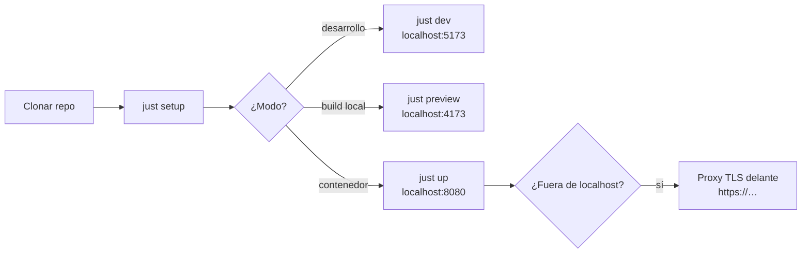

# Levantar el frontend

Guía operativa para poner en marcha Ether WebRelay en tres modos:
**desarrollo** (Vite con recarga), **preview** (build de producción local) y
**contenedor** (imagen nginx servible). Todos los comandos se ejecutan desde la
raíz del repositorio y delegan en `helpers/shell/` (regla 01).



!!! warning "Contexto seguro obligatorio"
    Los navegadores solo permiten capturar cámara, micrófono y pantalla en
    **HTTPS** o en **`http://localhost`**. Por eso todos los modos escuchan en
    `localhost`; para exponerlo en red hace falta TLS (ver
    [Exponer fuera de localhost](#exponer-fuera-de-localhost)).

## Requisitos

| Herramienta | Versión | Necesaria para |
|-------------|---------|----------------|
| Node.js | 24 LTS (`source/frontend/nodejs/webrelay/.nvmrc`) | desarrollo y preview |
| npm | la incluida con Node | dependencias |
| GNU make, just, bash | — | orquestación |
| podman (recomendado) o docker | — | modo contenedor y `make ci` |
| Navegador | Chromium 94+, o Safari/Firefox con WebCodecs y AudioWorklet | usar la app |

Comprobación rápida:

```bash
node --version && npm --version && make --version | head -1 && just --version
```

```bash
podman --version || docker --version
```

## 1. Preparar el entorno

```bash
just setup
```

Instala los git hooks (`core.hooksPath = .githooks`) y las dependencias del
frontend con `npm ci` (reproducible desde `package-lock.json`). Solo
dependencias, sin hooks: `make install`.

## 2. Modo desarrollo

```bash
just dev
```

- Abre **http://localhost:5173**.
- Recarga en caliente del código TypeScript; editar cualquier `.pug` recarga
  la página completa.
- Otro puerto: `just dev --port 3000`.
- Manual: `just dev --man`.

## 3. Preview del build de producción

```bash
just preview
```

Ejecuta `make build` (typecheck + `vite build` → `source/frontend/nodejs/webrelay/dist/`)
y lo sirve en **http://localhost:4173**. Sirve para comprobar el bundle real
(ffmpeg.wasm queda como asset aparte que solo se descarga al exportar OGV).

## 4. Modo contenedor

```bash
just up
```

1. Detecta el runtime: **podman** primero; si solo hay docker, lo usa con aviso.
2. Construye `containers/frontend/Containerfile` → imagen `ether-webrelay:local`
   (compila con Node 24 Alpine y sirve con nginx sin privilegios).
3. Arranca el contenedor `ether-webrelay` publicado **solo en
   `127.0.0.1:8080`**.

Abre **http://localhost:8080**.

| Acción | Comando |
|--------|---------|
| Otro puerto | `just up --port 8091` |
| Ver logs | `just logs` |
| Detener y eliminar | `just down` |
| Solo construir la imagen | `make app-image` |
| Forzar docker | `CONTAINER_RUNTIME=docker just up` |
| Manual | `just up --man` |

Verificación:

```bash
curl -s http://localhost:8080/healthz
```

Debe responder `ok`. La imagen también declara un `HEALTHCHECK` sobre ese
endpoint.

### Qué sirve el contenedor

| Ruta | Comportamiento |
|------|----------------|
| `/` | `index.html`, `Cache-Control: no-cache` |
| `/assets/*` | JS/CSS/wasm con hash en el nombre, caché inmutable de 1 año |
| `/healthz` | `200 ok` (sin log de acceso) |

Cabeceras de seguridad: `Content-Security-Policy`, `Permissions-Policy`
(cámara, micrófono y captura de pantalla solo para el propio origen),
`X-Content-Type-Options: nosniff` y `Referrer-Policy: no-referrer`.

## 5. Conectar con un puente

El frontend no publica en RTMPS por sí mismo: necesita un puente que
implemente el [protocolo v1](protocol.md).

1. En **URL del puente** usa `wss://…` (en desarrollo se acepta
   `ws://localhost:<puerto>` o `ws://127.0.0.1:<puerto>`).
2. **Token de acceso**, si el puente lo exige.
3. **Destino RTMPS** (opcional): URL `rtmps://…` y clave de stream. Déjalo vacío
   si el puente ya conoce el destino (recomendado: la clave no pasa por el
   navegador).
4. Elige fuentes y calidad, y pulsa **Iniciar transmisión**. El navegador
   pedirá permisos y qué pestaña, ventana o pantalla compartir.

El indicador de estado pasa por `conectando` → `en vivo`; si la red cae verás
`reconectando` y la transmisión se reanuda sola.

## Exponer fuera de localhost

El contenedor solo escucha en loopback a propósito. Para servirlo en red, pon
un proxy con TLS **en el mismo host**. Ejemplo con Caddy (certificado
automático):

```bash
caddy reverse-proxy --from webrelay.example.com --to localhost:8080
```

Equivalente en nginx (con tus certificados):

```nginx
server {
    listen 443 ssl;
    server_name webrelay.example.com;
    ssl_certificate     /etc/ssl/webrelay.crt;
    ssl_certificate_key /etc/ssl/webrelay.key;
    location / { proxy_pass http://127.0.0.1:8080; }
}
```

Con el sitio en HTTPS, el puente debe ser `wss://`: los navegadores bloquean
`ws://` desde páginas seguras (y la CSP solo permite `ws://` hacia localhost).

## Solución de problemas

| Síntoma | Causa | Solución |
|---------|-------|----------|
| `bind: address already in use` en `just up` | El puerto 8080 está ocupado | `just up --port 8091` (o libera el puerto) |
| `Port 5173 is in use` en `just dev` | Vite usa `strictPort` | `just dev --port 3000` |
| "Esta página debe servirse por HTTPS…" | Se abrió por IP o nombre sin TLS | Usa `localhost` o pon un proxy TLS |
| "Este navegador no tiene las APIs necesarias: …" | Sin WebCodecs/AudioWorklet | Actualiza o usa Chromium |
| "Se denegó el permiso de captura." | Permiso rechazado | Permite cámara/micrófono/pantalla en la configuración del sitio |
| No aparece la opción de audio del sistema | Depende del navegador y del SO | Comparte una **pestaña** en Chromium, o desactiva "Audio del sistema" |
| El puente no conecta (`ws://192.168…`) | La CSP solo permite `ws://` a localhost | Usa `wss://` o `ws://localhost` |
| `No container runtime found` | Ni podman ni docker | Instala podman |
| Pantalla negra en la vista previa | Fuente aún sin frames o pestaña compartida cerrada | Espera un segundo; si cerraste la compartición, la sesión se detiene |

Cada helper deja un log de auditoría en `/var/log/ether-webrelay/` o, si no
hay permisos, en `/tmp/ether-webrelay/`.

## Referencias

- [Guía de inicio](getting-started.md) · [Arquitectura](architecture.md) · [Protocolo v1](protocol.md)
- Manuales: [dev](man_dev.md), [preview](man_preview.md), [up](man_up.md),
  [down](man_down.md), [logs](man_logs.md), [app-image](man_app-image.md),
  [build](man_build.md)
