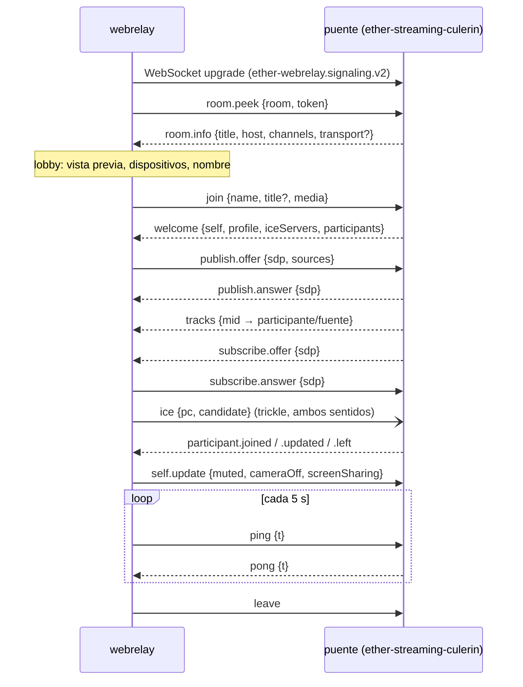

# Señalización Ether WebRelay v2 (WebRTC)

Contrato entre el **webrelay** (este repositorio, navegador) y el **puente**
(implementación en
[`ether-streaming-culerin`](https://github.com/rafex/ether-streaming-culerin)),
que alberga la videollamada y publica la sala en RTMPS. El cliente **no conoce
RTMPS**: solo envía cámara, pantalla y audio, y recibe a los demás
participantes.

- Implementación de referencia del cliente: `src/domain/signaling.ts`
  (tipos y parser) y `src/application/webrtc-call.ts` (flujo).
- Doble de prueba ejecutable: `tests/support/dev-bridge.mjs` (`just bridge-dev`),
  señalización completa + mini SFU con werift. Úsalo como ejemplo vivo.

## Transporte

- WebSocket `wss://` (`ws://` solo en loopback durante el desarrollo).
- Subprotocolo **`ether-webrelay.signaling.v2`**: el puente debe aceptarlo o
  rechazar el upgrade.
- Mensajes de **texto JSON**, un objeto por mensaje con campo `type`.
- Mensajes desconocidos se ignoran en ambos sentidos (compatibilidad hacia
  adelante).

## Modelo de medios

Cada participante mantiene **dos** `RTCPeerConnection` con el SFU del puente:

| Conexión | Quién ofrece | Dirección | Contenido |
|----------|--------------|-----------|-----------|
| `publish` | cliente | `sendonly` | cámara, micrófono, pantalla, audio de la pantalla |
| `subscribe` | puente | `sendonly` desde el puente | pistas de los demás participantes |

- `bundlePolicy: max-bundle`: una oferta **sin secciones de medios es
  inválida**. El cliente no ofrece `publish` hasta tener al menos una pista
  (un participante puede entrar solo a ver), y el puente no debe enviar un
  `subscribe.offer` vacío.
- Activar/desactivar cámara o pantalla con un transceiver ya negociado se
  hace con `replaceTrack` (sin renegociar); el estado visible viaja en
  `self.update`.
- Calidad: la dicta el puente con `profile` y el cliente la aplica con
  `RTCRtpSender.setParameters` (`maxBitrate`, `maxFramerate`,
  `scaleResolutionDownBy`).



## Mensajes cliente → puente

| `type` | Campos | Cuándo |
|--------|--------|--------|
| `room.peek` | `room`, `token` | Al abrir el lobby (y al reconectar antes de entrar) |
| `join` | `name` (≤ 60), `title?` (≤ 80), `media: {audio, video}`, `resume?` (id previo), `resumeToken?` (secreto del `welcome`) | Al pulsar "Entrar"; con `resume` + `resumeToken` tras una caída del WebSocket |
| `publish.offer` | `sdp`, `sources: {mid: "camera" \| "microphone" \| "screen" \| "screen-audio"}` | Oferta inicial y renegociaciones (nuevas pistas, ICE restart) |
| `subscribe.answer` | `sdp` | Respuesta a cada `subscribe.offer` |
| `ice` | `pc: "publish" \| "subscribe"`, `candidate: {candidate, sdpMid, sdpMLineIndex}` | Trickle ICE |
| `self.update` | `muted`, `cameraOff`, `screenSharing` | Tras entrar y en cada cambio |
| `ping` | `t` (ms del cliente) | Heartbeat cada 5 s |
| `leave` | — | Salida voluntaria |

`sources` es obligatorio para que el SFU sepa qué pista es la cámara y cuál la
pantalla (no se puede deducir del tipo de medio).

## Mensajes puente → cliente

| `type` | Campos | Efecto en el cliente |
|--------|--------|----------------------|
| `room.info` | `room`, `title`, `host: {name, avatar?}`, `channels: string[]`, `transport?: "webrtc" \| "websocket"` | Pinta el lobby; `channels` es informativo (youtube, twitch, facebook…); `transport` sobrescribe el de `config.json` |
| `welcome` | `self`, `resumed`, `resumeToken`, `profile?`, `iceServers[]`, `participants[]` | Admite al participante; crea las conexiones (o las conserva si `resumed`); guarda `resumeToken` para reanudar |
| `publish.answer` | `sdp` | Completa la negociación de `publish` |
| `subscribe.offer` | `sdp` | El cliente responde con `subscribe.answer` |
| `ice` | `pc`, `candidate` | Se aplica (o se encola hasta tener descripción remota) |
| `tracks` | `tracks: {mid: {participant, source}}` | Mapea pistas remotas a participantes; se acumula |
| `participant.joined` / `participant.updated` | `participant: {id, name, title?, muted, cameraOff, screenSharing}` | Lista y estados |
| `participant.left` | `id` | Quita al participante y sus pistas |
| `profile` | `profile` | Cambio de calidad en caliente |
| `pong` | `t` (eco) | Mantiene viva la conexión |
| `error` | `code`, `message`, `fatal` | `fatal: true` termina sin reintentos |

### Perfil de calidad

```json
{ "width": 1280, "height": 720, "framerate": 30, "videoBitrate": 2500000,
  "audioBitrate": 128000, "screenFramerate": 15, "screenBitrate": 2500000 }
```

Todos los campos son opcionales (se completan con los valores por defecto
de `config.json`); valores fuera de rango invalidan el mensaje. El
participante solo elige resolución de cámara (Automática/360p/720p/1080p),
siempre acotada por el perfil.

### Códigos de error conocidos

| `code` | Mensaje mostrado |
|--------|------------------|
| `invalid-token` | El enlace de invitación no es válido o ha caducado. |
| `room-not-found` | La sala no existe o ya terminó. |
| `room-closed` | La sala se ha cerrado. |
| `room-full` | La sala está llena. |
| `kicked` | El anfitrión te ha retirado de la sala. |
| otro | `message` del puente, o un texto genérico con el código |

## Reconexión

1. **Señalización caída**: el cliente reconecta con backoff exponencial
   (0.5 → 10 s, ±20 % jitter, 20 intentos); también si no recibe nada durante
   3 heartbeats.
2. En el lobby reenvía `room.peek`; en la llamada reenvía `join` con
   `resume: <self>` y `resumeToken: <el recibido en welcome>`.
3. Si el puente conserva la sesión (y el token coincide) responde `welcome
   {resumed: true}` y el cliente mantiene sus conexiones WebRTC; si no, admite
   al cliente como invitado nuevo (`resumed: false`, otro `self` y otro
   `resumeToken`) y el cliente recrea las conexiones y vuelve a publicar.
4. **Medios caídos** (`publish` en estado `failed`): el cliente hace ICE
   restart con una nueva `publish.offer`. Para `subscribe` es el puente quien
   debe ofrecer de nuevo.

## Seguridad

- El token viaja en `room.peek` (no en la URL del WebSocket, que suele
  terminar en logs).
- El puente valida `Origin`, el token y límites de tamaño de mensaje.
- Los avatares solo se aceptan como URL `http(s)`.
- El cliente nunca recibe ni envía destinos o claves RTMPS.
- Los ids de participante (`p-1`, `p-2`…) son secuenciales y públicos para toda
  la sala: **no autentican**. Reanudar una sesión exige el `resumeToken`
  (128 bits aleatorios) que solo recibió su dueño en `welcome`; sin él, el
  puente ignora `resume` y no toca la sesión ajena.

## Modo alternativo `websocket`

Si `transport` es `websocket`, la señalización solo se usa en el lobby y los
medios del participante (compuestos en un único video + audio mezclado) se
envían con el [protocolo binario v1](protocol-websocket.md). En ese modo no se
reciben otros participantes.
