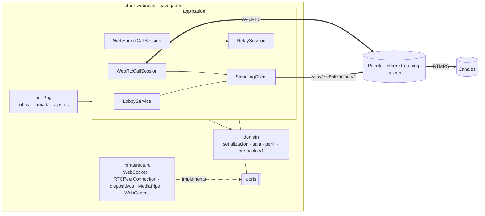

# ARCHITECTURE.md

Índice de arquitectura. Los componentes, límites y flujos canónicos viven en
`architecture/ARCH-XXXX-<slug>.md`.

## Debe responder

- Cuales son los modulos o bounded contexts principales.
- Que responsabilidad tiene cada modulo.
- Donde estan los limites entre capas.
- Que dependencias estan permitidas o prohibidas.
- Cuales son los puntos de integracion externos.

## Vista general

Aplicación de navegador única (`source/frontend/nodejs/webrelay`) con
arquitectura hexagonal: antesala + videollamada WebRTC. Integración externa:
el **puente** (`ether-streaming-culerin`) por la señalización v2
(`docs/signaling.md`) y WebRTC; en modo alternativo, por el protocolo binario
v1 (`docs/protocol-websocket.md`). Detalle en `docs/architecture.md` y
ARCH-0005.

| Módulo | Responsabilidad | Puede depender de |
|--------|-----------------|-------------------|
| `domain/` | Señalización v2, sala, invitación, config, perfil de calidad, preferencias, vistas, atajos, layout, estadísticas, protocolo v1 y políticas | nada |
| `ports/` | Señalización, PeerConnection, dispositivos, preferencias, efectos, pipeline, transporte, tiempo | `domain/` |
| `application/` | `SignalingClient`, `LobbyService`, `WebRtcCallSession`, `WebSocketCallSession`, `RelaySession`/`BridgeLink` | `domain/`, `ports/` |
| `infrastructure/` | Adaptadores de navegador | `domain/`, `ports/` |
| `ui/` | App, lobby, llamada, ajustes, grabación | todos |

Restricción verificada por `tests/architecture/layers.test.ts`: `domain/` y
`application/` no usan APIs del navegador ni paquetes npm.

> El CLI o MCP pueden generar esta sección desde `architecture/`. No escribir texto entre el encabezado y la tabla.

## Componentes

| ID | Estado | Componente | Tags |
| --- | --- | --- | --- |
| [ARCH-0001](./architecture/ARCH-0001-capas-hexagonales-del-webrelay.md) | active | Capas hexagonales del webrelay | component/frontend, concern/architecture, pattern/hexagonal |
| [ARCH-0002](./architecture/ARCH-0002-pipeline-de-medios-del-navegador.md) | active | Pipeline de medios del navegador | component/media-pipeline, concern/sync, tech/webcodecs |
| [ARCH-0003](./architecture/ARCH-0003-enlace-con-el-puente-y-m-quina-de-estados.md) | active | Enlace con el puente y máquina de estados | component/bridge-link, concern/resilience, concern/protocol |
| [ARCH-0004](./architecture/ARCH-0004-estructura-del-repositorio-y-tooling.md) | active | Estructura del repositorio y tooling | component/tooling, concern/build, rule/ether-best-practice |
| [ARCH-0005](./architecture/ARCH-0005-lobby-se-alizaci-n-y-llamada-webrtc.md) | active | Lobby, señalización y llamada WebRTC | component/call, component/lobby, concern/architecture |
